# 																		某牛XY的经历

**阅前杂谈：**

1. 此文篇幅较长，如能耐心看完，你想了解的问题应该都能在这里找到答案。希望我的这些经历能作为你的前车之鉴，帮你规避不必要的经济损失。 
2. 这段经历的荒谬程度，文中写出来的，不过是冰山一角。还有很多因篇幅、隐私所限，不便逐一列举。
3. 文中的图片只是极少一部分，还有很多地方也无暇一一配图。但我相信，目前的这些信息量，已经足够大家看清全貌。
4. 现阶段去培训机构基本上完全没必要。因为现阶段AI水平已经完全超越机构所谓的“讲师”，AI所随便做的一个项目，都碾压机构的名为“企业级项目”，实为玩具demo。对于这方面如果有怀疑的，可以随便买个ai试一下，然后在看一下机构的项目（正文里面有）。
5. 千万不要相信什么主播推荐，例如典型的某龙丶某迅。这种基本都是签了招生协议的。他们为了人头费各种春秋话术，话只捡对他有利的说，只说一半，引导你自我脑补。一个人头4-5K。而且这部分成本，实际上机构也是通过涨价转移到学员头上了。
6. 此机构完全就是割韭菜，其能逆天到什么程度呢。就是它们可以在其完全没有任何实际经验的情况下。比如现在AI火，它们就能搞个什么AI智能体开发班。之前嵌入式火，它们就是开个嵌入式班。其实际课程安排就是看别的机构，以及招聘要求。然后在网上到处复制搬运资料，整理成它们所谓的课件，然后安排所谓的“讲师”现场学习。讲师通过AI搞明白一点基础皮毛就开始水课。

## 目录
1. [第一阶段学习经历](#第一阶段)
2. [第二阶段学习经历](#第二阶段)
3. [第三阶段学习经历](#第三阶段)
4. [第四阶段学习经历](#第四阶段)
5. [就业阶段经历](#就业阶段)
6. [杂谈补充](#杂谈补充)
7. [整个学习体验](#个人学习体验)
8. [此机构给人的感受](#个人对机构的感受)
9. [此机构讲师对其项目的评价](#此机构自己的讲师对他们的项目的评价)
10. [关于直播](#关于直播)
11. [内部学员部分评价截图](#内部学员部分评价截图)
12. [网上部分评价截图](#网上部分评价截图)
13. [结语](#结语)

**一丶学习经历。**

我是某牛嵌入式的学员，当初看网上差评”很少“，故选择此机构进行嵌入式学习。

## 第一阶段
**第一阶段**是吴老师进行的教学，吴老师此前为他们Java总监。

内容主要是C语言和SQLITE数据库加上一些Linux的基础操作命令。因为此位讲师前面授课速度很快。导致整个授课时间实际大概三个星期不到，两个星期多一点，课程就上完了。 然后后面的时间就变为自习。讲师在教室坐着，学员自主学习。 后面由于我们实在坐不住了，机构也知道我们颇有微词，这位讲师就自己加了一点额外的知识，如Git的pull丶push丶冲突解决，字节序列化。当时我们在最后的所谓的项目周得知原本的二阶段讲师ZYF离职了，需要和上一批的学员进行合班，具体详情后面在表。

第一阶段宣传的内容基本上涉及到了，不过课程内容的深度与想象之中有差距。

例如，其中数据结构部分，印像中好像是两节课一共四个小时的时间讲完了，每种结构给你演示一下。

项目做的是一个控制台程序，是叫智能门锁还是酒店管理系统来着。主要功能就是使用C语言对数据库进行一下增删改查操作。比如输入一个数字0，添加用户，输入数字1，删除用户。用了一张IC卡，贴上去可以读信息，本质也是一个字符串。

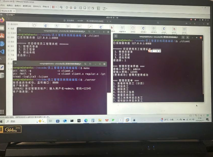

本来是说和硬件结合，结果到了时间，购买的锁还没有到货！

吴老师无奈，故只发放了除锁以外的部分配件。配件是由一个盒子装着，给我感觉应该是从网上购买的。里面装着【F103C8T6丶W25Q64丶杜邦线丶蜂鸣器丶IC卡丶dht11温湿度传感器丶ESP8266Wi-Fi模块丶OLED屏幕丶,MPU6050模块丶stlink烧录器丶USB转TTL丶马达丶等等小零件】，当时如果我没记错的话，包装盒里面还有一张纸，类似宣传说明卡片，**上面所写商家是网上一个进行32单片机教学的UP**。（如果我没记错的话，大概率是江协科技。）

当时我们部分学员曾吐槽，“**什么情况呀，开班了，东西还没买，这不是好比开个饭店，顾客上桌了，才去买菜吗？**”。

又等了几天，锁终于到货。但是出现什么别的问题无法解决，最后就把**硬件部分阉割**了。

在第一阶段结束的时候。**机构首先问我们这一期的学员对合班持有什么态度**。我们多个学员不赞成合班，对合班持有反对意愿，对方给出的说法是单片机和C++QT不相干，最后合班。 

**当时我们反应过一阶段的项目缺乏含金量，无法写到简历上。**机构方面给出的说法是：第一阶段教的基础，简单是正常的，然后用我们没学过的知识拷问我们。只要答不上来，就会说，你看你们这个都不会，还讲简单。我们同时对后面的项目含金量表示了质疑，对此，机构方面的说法是，项目技术都是通用的，换个壳就行了，同时提醒我们，到时候别给你们布置任务，你们又觉得困难，无法完成。

在后续的学习中我们继续表达了对项目含金量的担忧，zg讲师回应我们说，**他觉得这方面不用过于担心，就业时候老师帮你们一起想项目**。

**对于单片机老师的水平，我们也表达了担忧，因为据我们了解机构新安排的单片机讲师为zg，zg之前主要讲授Java，可能缺乏嵌入式实际工作经验**。当时机构的另一位讲师，也就是我们后面的qt和Linux驱动的讲师rsj，给我们的回答是，“别人教都没教你们，你们怎么知道zg讲师教不了你们。zg老师年纪比我都大”。

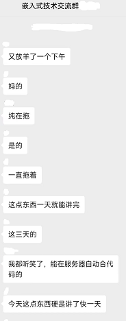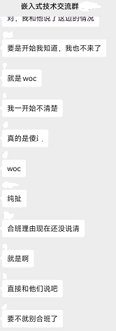

## 第二阶段
**第二阶段**是rsj讲师进行的教学。

其实**二阶段**官网宣传的是单片机，原本的教学老师本来是安排的zyf讲师。此位讲师之前是在华清做LINUX驱动方面的教学，听说拥有多年的LINUX驱动方面的工作经验。

但是**一是因为当时此位讲师离职了**。

**二是因为，新安排的单片机（另一位宣传拥有多年单片机经验，精通ARM的zg讲师）讲师此时还在没人的教室学习江协科技的单片机入门教程。**			tips：估计没有江协科技丶正点原子，这些机构的嵌入式班都开不起来。

所以**实际情况是最后合班**，和上一期的学员一起学习的原本官网宣传的第三阶段的内容，由rsj讲师，讲解C++/QT相关的知识。此位讲师听别的学员讲，好像也是之前在华清教学，和离职的zyf讲师是朋友。

此位老师的教学习惯是一节课约一小时，课间休息20分钟左右，课中包含大量敲Demo的时间。下午课程，常在不到6点，五点过后，很大概率就停止授课了。让学员自己消化课中所讲知识内容。

二阶段讲的是C++基础语法和QT控件的基本认识介绍和简单使用，使用的**课件是在网上找的，和网上公开资料多处地方高度相似，标点符号都相同。rsj讲师有次在课上聊天，自述之前是主做MFC的，整体学习下来，C++基础知识部分教的确实不错，QT部分相比C++部分则是差很多。整体体验勉强尚可。**

（部分对比课件的来源[程序员的自我修养_happy 天堂的博客-CSDN博客](https://blog.csdn.net/qq_43205256/category_11913773.html)。）

**网上公开资料和机构课件对比截图：**

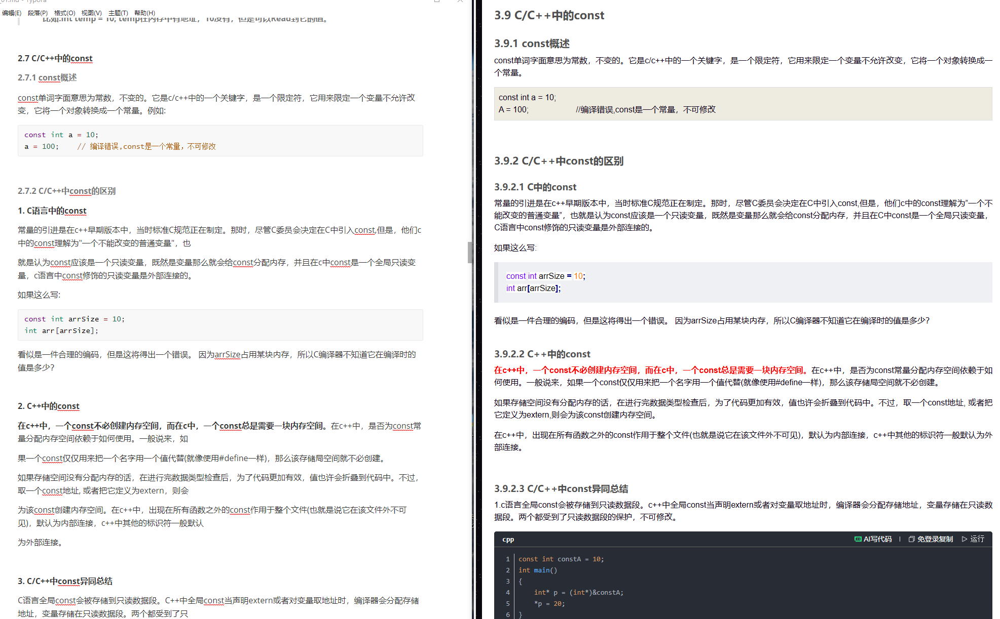

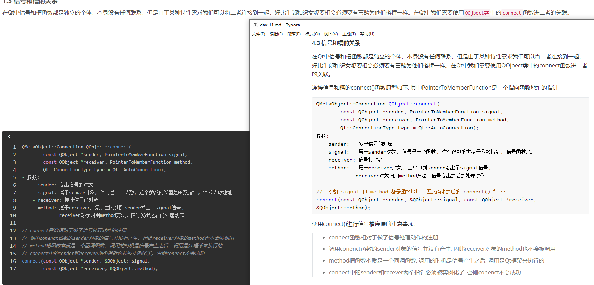

**项目部分个人感觉是一言难尽，某位学员原话“教你最基础的，项目给你拉一坨大的”**，仿佛是为了验证他说过的话一样“别现在都喊简单，到时觉得困难，又玩不成任务”。当时让我们做的项目是仿照网上【飞扬青云】的 [QT实现物联网管理平台] 写出一个类似的软件。项目需求是使用AI工具生成的一个PDF。 然后两个班的学员分为两组。要求一个星期做出来。学员基本上都不会做，没办法只能使用CHAT_GPT，不断复制，做出来了一个**无法见人的程序**。

有的学员不想在学习阶段使用AI，认为AI复制对于学习没有帮助，导致没有做出来，或者说做的比同期的学员更差。它们就认为此学员没有学好，做的项目不行。

 **飞扬青云** [QT实现物联网管理平台]（目标程序）

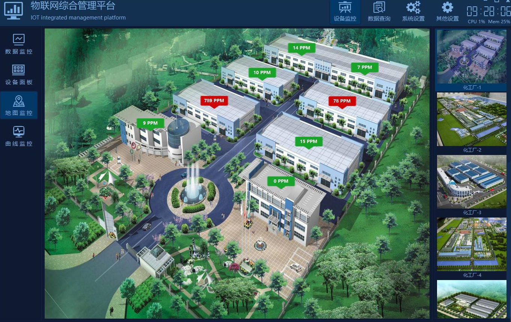

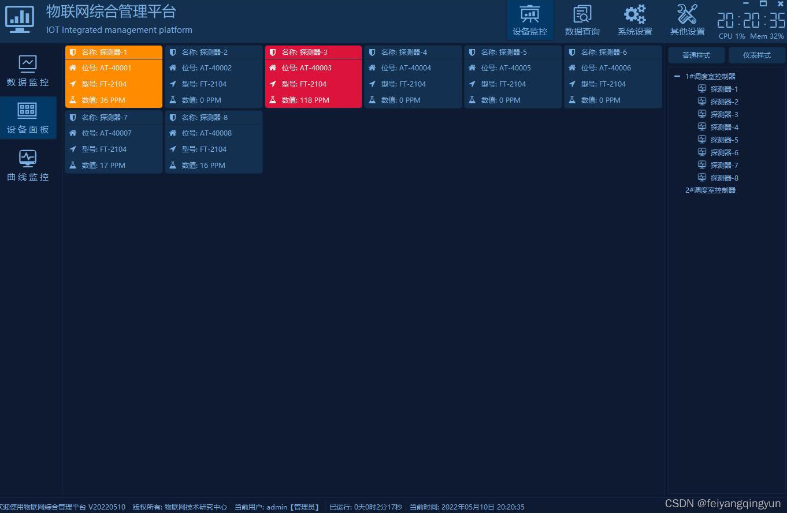

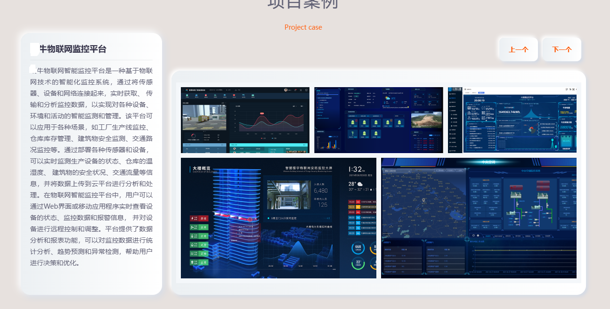

**学员的实际成品**

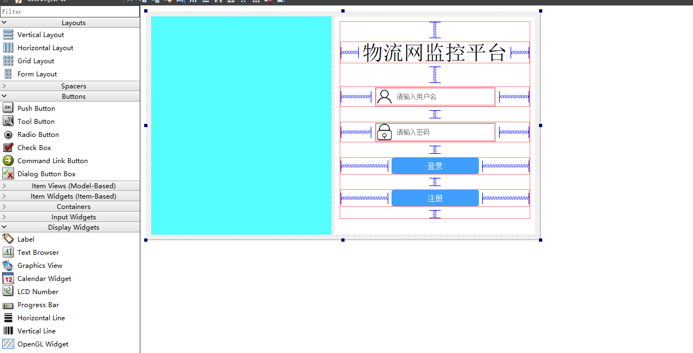

## 第三阶段

三阶段时候，**不出意外再次合班**（我们同下一批的人员一同学习，此时之前我们上一批的学员因为N京某牛这边没有驱动老师，某牛给他们购买机票，让他们飞往成都，和成都驱动阶段的学员一起进行学习，没记错的话，好像是由讲师Lzy为他们进行Linux驱动教学，**此位Lzy讲师师据之前已经离职的Zyf讲师说也是自学嵌入式，之前从事Java方面工作**）。

同时单片机Zg老师登场。

三阶段基本上主要教学内容为常见通讯协议丶stm32标准库配置丶stm32框图讲解。

**当时刚开始上课没几天，我们就发现其所讲内容基本就是江科大的教学视频，基本上所有示例DMEO丶插图都一模一样。当时就有学员讲“我之前就看见zg在空教室不知道在学习什么，原来是自学江科大啊”**

后面学的过程中，我们发现该讲师使用两台电脑讲课，**一台电脑显示江科大DEMO，用于照着敲。另一台电脑用于教学。**或许是第一次进行单片机授课，讲快了担心自己知识储备不够，进度把握不熟练，以至于课程延期了一个星期左右。

至于其他非江科大内容则更是浅显魔幻。

例如所谓的蓝牙丶透传丶mesh组网，不知道的读者可能听起来觉得听高端，实际大概授课内容就是把4G模块通过串口和单片机连接起来，然后发送对应的AT指令，通过串口调试工具查看调试。**并不是想象的讲解蓝牙协议一类的。**在实际面试之中，别人如果看你简历上写4G模块丶蓝牙相关，一般问你底层。机构老师给的说辞，就是让面试的学员说，之前的项目是公司买的模块直接用。

三阶段中期的项目是一个大家都知道的项目。**智能小车**，大概就是通过两路PWM控制两个轮子转动，然后老师不知在哪找了个PID算法，调其中的三个参数就行。 为了把小车立起来，调这个参数大概调了两个工作日。

末期的项目是**智能快递柜**，使用的是ESP32加一个触摸屏。使用LVGL制作一个包含确认丶取消按钮和数字0-9的界面。在界面上输入4位的验证码，根据匹配情况，发送一个高低电平，使继电器吸合或者弹开，代表开锁关锁。

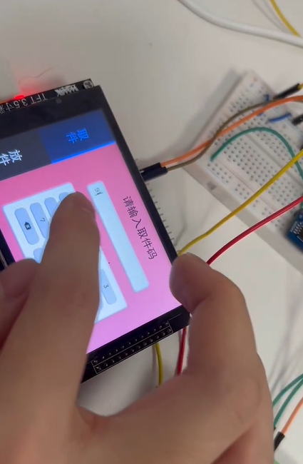

LVGL的话，并没有教学，知道我们不会，直接下载的LVGL的示例Demo进行了简单的修改，给了我们一个界面

关于FreeRtos，咨询E老师，询问这个知识教不教，官网当时宣传页面大概率是写了的。答复说是“**课程太紧，没有时间**“，等到就业时候我再教你们，后面投简历的时候，过来教学员跑了几个Demo。

**部分课件和江科大对比截图：**

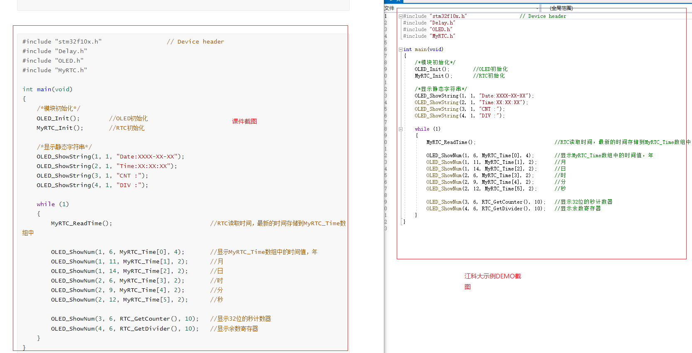

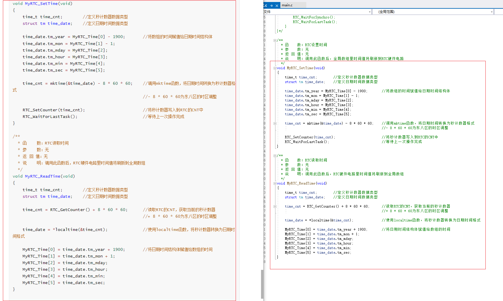

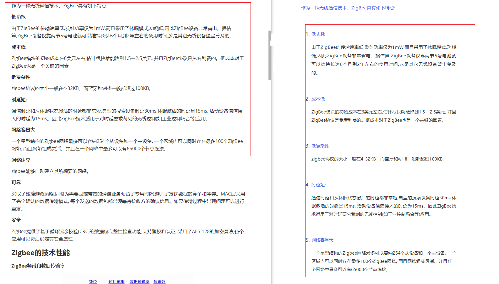

## 第四阶段

四阶段的讲师为教我们二阶段C++/QT的讲师Rsj。

教学使用的开发板为北京讯为RK3568。内容大概是前面近两个星期，学了制作最小文件系统（如手动一个文件夹文件夹的配置。还有使用BuidRoot丶Busybox工具进行制作）。

**当时其实几乎所有的学员都非常不满意。**

**一个是进度极慢。就算拿C都那边校区的进度来说，那边的相关部分就学习了1天左右。而我们这边近两个星期都在搞这个最小文件系统。**

**二是课程极度抽象，此位讲师应该是没有过Linux驱动方面的工作经验的，授课基本上就是把“课件”上的内容念一遍，然后再让学员把手“课件”上的demo敲一遍，因为Linux驱动方面的demo本就很长且很容易敲错。所以导致花在这方面的时间非常多。一天的授课过程基本上可以概括为读PPT—>敲demo—>闲聊—>下课（约20分钟）—>改demo。**

后面（两周）学习了几个Demo，如点灯丶文件IO丶总线等。课程就结束了。 

**在学习的课程中有学员获得到了北京讯为的资料手册。发现其教学课件和北京讯为手册一模一样**。简单来讲就是此位讲师把讯为手册原版复制制作一个单节课的PDF教学文档，有些地方还复制错了。于此同时，**我们发现所讲的内容，与B站北京讯为下面相关教学视频内容高度相似，且北京讯为的教学视频内容更加丰富且全面。**

整体教学给人感觉此位讲师大概率是缺乏相关工作经验的。我们学员也看见**此位讲师在朋友圈分享自己学习讯为手册demo的日常，其实也和教单片机的讲师zg是同样的情况，现学现卖。**

学员基本上都是差评。

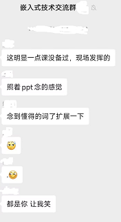

当时我们和C都那边学员聊过，C都那边学员吐槽没教什么。然后得知我们这边的情况后，感慨了一句，“**我早就知道他讲课不行，你们比我们还惨...**”

**部分课件与北京讯为手册对比图：**

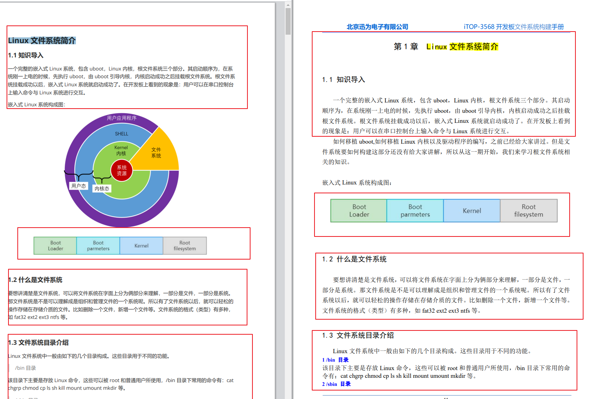

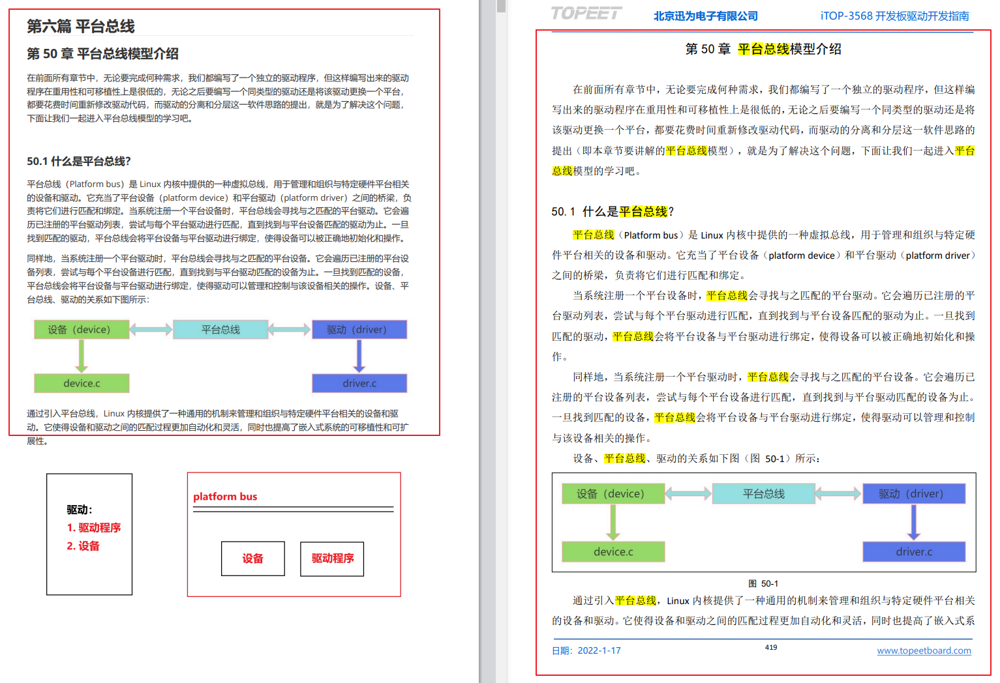

**项目是需求是使用AI工具生成的一个PDF。**

我们几乎所有学员完全做不出来。连**如何把用Qt写的程序写到开发板进去都不会**，最后是**通过问GPT勉强写进去**。所以我们几乎都放弃了。不准备找LINUX驱动方面的工作。开始提前背单片机面试题八股文。这里补充一下，这个面试题是一个500MB的压缩包，应该是其为了应付学员的多次催促而在网上购买。

此位讲师当时已经给新来的学员讲课，不时抽时间过来问我们进度。我们肯定是没进度的。遂说我们不愿意做项目。我们很含蓄的表达能力有限，不会做。 

后面多次抽查进度，无法。其中一位学员通过询问GPT成功点灯丶打开摄像头，我们也进行复制。以求让这位老师看到进度。然后继续背单片机面试题，在后面一次的进度询问中，这位老师发现此学员背面试题，干项目无关的事，大部分学员项目毫无进度。进行了批评，认为我们态度欠佳。

此时这位学员实在忍受不了，对其说，”你什么都不教，我们怎么做！？“。此位讲师则回应，别人能做，你怎么不能做？（此逻辑也是神奇。）（Tips：能做的那位学员进度最快，大概实现了修改开机Logo丶点灯丶打开摄像头等功能，在进行Opencv的编译。）然后被谈话，认为其态度不好，不尊重老师。

**学员吐槽：**

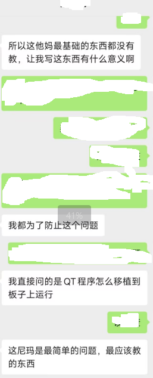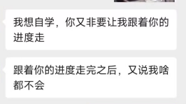

**最后我们的项目成品图：**

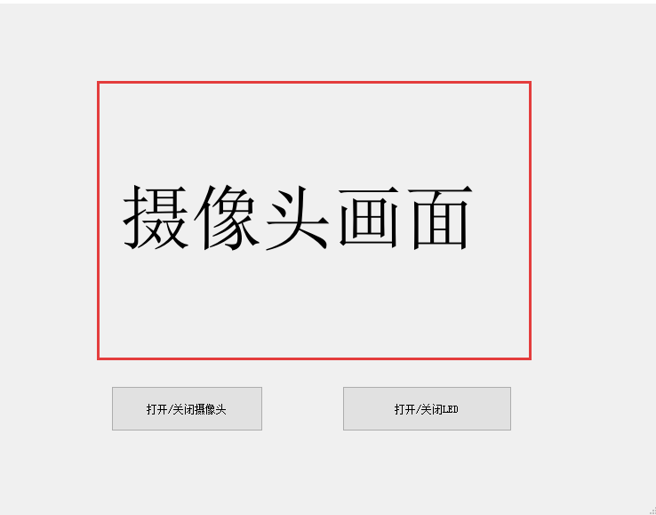

## 就业阶段

学了近6个月，于9月底开始制作简历，大家冥思苦想，绞尽脑汁开始想项目。

之前承诺帮我们想项目的zg老师此时不知在何处，后面在我们的不断追问下，给我们发了几个**立创开源网站上的项目的链接**，我没记错的话，应该是**一个智能手表**类的，**一个医用心电图显示**一类的。然后这位老师口述以前的一个工作项目经历，描述了一个红外中医诊断的项目的大体业务逻辑。让我们以此进行参考。

由于实在想象不出来。就业老师一直催着提交简历，没办法，把上一期的学员的简历（GPT生成）抄了下，**里面写了一些自己都不了解的技术，没办法，靠学的知识无法拼筹一个看起来还像样的项目。总不能把智能小车丶门锁往上面写吧？**加上GPT的帮助。**最后生成了几个自己都觉得假大空的项目**。

**后来机构把我们的简历发给后面的学员，后面的学员抄我们的简历，实际上我的简历也是~~**

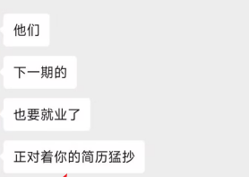

后面因为编造简历进度的问题，我们的下一批学员还和他们产生过一次口语摩擦，认为其“张口就来”。吐槽他们作为机构只会催交简历，却无法提供任何帮助，无法提供项目，把编简历的任务完全交给学员。

然后开始人事模拟面试，大概内容是：帮忙看了下文字排版是否合理丶自我介绍丶问你为什么投我们公司，你之前公司在哪儿丶有多少人丶你是属于哪个部门的丶部门有多少人，期待薪资多少丶离职原因等。

技术模拟面，大概内容是：自我介绍，**粗略问一下项目**。**主要询问**串口丶SPI丶IIC时序丶PWM，你的项目用的什么芯片丶拥有多少个引脚，RAM丶SRAM多大，Flash擦写步骤丶const和define的区别丶const修饰变量的几种情况丶C++深浅拷贝等等类似基础八股问题。

最后开始海投简历。蜗牛的就业辅导人员规定每天各个平台投递丶沟通多少家，例如BOSS每天投递40家，每家沟通4条语句。

示例： 

第一句：您好，能和您沟通下吗？

第二句：我叫某某某，拥有X年嵌入式/Java开发经验，熟悉某某技术，拥有某某经验。

第三句：最近的项目是某某，这个项目是做什么的，用到了某某技术。

第四句：能否约个面试呢？

（别人大部分HR看到你这种消息轰炸，一般是会回复你的，给你机会。但是过不过那就真看运气了。）

对于不愿意投的（因为很多职位，我们自认是完全达不到其要求水平的。比如 LINUX高级驱动开发丶高级嵌入式开发，要求3-5丶5-10年），这时候就业老师会要你的账号，帮你投。

然后开始被企业面试官各种拷打。项目一问，我们是啥也说不清，一碰就碎。

例如你简历项目中编了低功耗方面，我们**以为**是问睡眠模式一类的，准备的回答是睡眠模式分为几种，触发激活条

件是什么。**实际**别人问你，你们低功耗延长了多少待机时间？电流是多大？

例如里面写了RK3568相关项目，因为这个板子确实市面上用的比较多，所以有的企业看到RK系列的项目，就会给面试机会。但是问的基本不会。

还有例如，别人问你，你项目中使用过Mpu6050模块是吧，他们采集到的数据你们是直接使用吗？（挖坑）因为我们当时就是直接使用，从来没有人告诉我们这方面的问题。所以直接傻乎乎的回答“是的，我们直接使用”。

然后别人就明白了，**直接质问“你们是培训的吧？这么基础的问题不知道？采集到的数据能够直接使用吗？你们诚信有问题！”**。其中类似事情数不胜数。

在我们在去面试路上的时候，还等着别人问八股呢，什么SPI时序丶IIC时序丶中断丶C语言一类的......。

## 杂谈补充

1.有人可能会问关于培训完毕后，学员的去向等情况。这里简单说下我了解的，大概去向分为几类：

​	1.拿到嵌入式开发offer，且干的是正儿八经开发工作，且能干下去度过试用期的。

​	2.拿到嵌入式offer，但是干的非开发工作，如调试丶测试丶一类。

​	3.实习丶助理一类。

​	4.qt方向。

​	5.彻底放弃，干别的行业的工作。

第1类是什么情况呢？这部分学员其实也没有独立开发丶做项目的能力。基本上是学历不错丶加上进的中大型公司，**这种公司一般会给你1-2月熟悉时间，然后分配的任务较为简单，如可能一两个月就调通几个IIC丶SPI通讯。**还有**可能进去几个月没写过代码等等**。只有**极少极少极少部分学员**可以通过包装进去直接独立开发。这部分学员是通过自己补充学习硬磕待下去的。

此类去向的学员，不少进去以后发现干不了，只有不停的更换公司。或是运气好碰到一家公司刚开始派发的任务较为简单。或是进去的时候，公司没什么业务。才有可能度过试用期转正。

大部分都属于2.3.5类。2.3类面试属于问的相对简单，公司大概也没指望你进去能干什么有难度的活。可能就是问你一下C语言基础知识丶或者和你简单聊下天，问下基本情况，就让你进去了。**如果你是准备找这一类。你不培训，网上免费课程随便看一下，背一下题目，也可以进去。**

第4类就我了解的几乎没有走这个方向的。 

整体来说并不顺利。

至于更加详细的情况，**这里为了保护其余学员的隐私，不做说明。**

2.可能有人会问。难道就没有一个找到工作的吗？这里说一下，肯定有人能找到。而且薪资不错，如果都找不到，市面上的机构早倒闭了。

但是你要分清这类学员的比例，有几个这样？分清这里面有几分运气，你能保证你有一样的机会吗？分清这些学员的自身条件。你有别人的学历吗？

不同学历丶年龄。面对同样的面试机会，别人对你的期望是不同的。对于年轻学历高点的来说，别人去面试，可能简单问几个问题，不管答不答的上来，别人都要了。对于年纪大或学历一般的学员来说。你去面试，可能就是重点扣项目细节，稍有一点不满意就PASS了。

还有，培训质量与找到工作和两者之间并没有必然联系，不能以后者反推前者。举个例子，一个八十岁老太太招一批人，给学员放视频。最后肯定也有人能找到工作，但是这能说明这个老太太授课质量好吗？

3.关于就业，我粗略说一点，当时我和【感恩姐】进行过一次简单谈话，表达了我对就业的担忧，大概咨询了以下几个问题：

​	1.上一批学员好像也没有真正做嵌入式开发的，感觉不好找。

​	2.进去感觉很难待下去。

对方的回应是：你就说他们工资是不是正常发，给没有给他们钱，他们的下一份工作绝对比上一份好找。因为工作经历是真实的。你都没进去，你担心什么，进去了再说，你想的太远了，现在不要考虑这些事。

**我感觉与其沟通意义不大**，遂没有继续深入进行下去。

4.关于就业数据

据我所了解的学员就业情况和他们宣传的就业存在较大差距。机构的就业标准给我的感觉是拿到offer丶或短期就业后离职丶或拿到的offer为开发offer，但是实际工作内容非软件开发，以上都算就业。哪怕你一分钟班没上过，入职手续过不去也会写在官网。当你说拿到offer那一刻，他们就会让你发一个offer截图，当做宣传的依据。

5.关于就业服务

就业服务基本就是模拟面试（人事面丶技术面），前面也说了这两者面试的大概内容，除了消除你面试的一点紧张感外没有别的作用，和实际面试差距很大。

然后督促学员投简历丶电话录音。根据录音，他们就业人员会给你解答一点学员面试中话术回答不好的地方，例如语气丶用词丶离职理由等等。

技术问题一般是自己搜，当然，老师有空也会给你整理下。但是这方面意义不大，因为基础知识随便一搜就可以得到非常确切的答案。

面试中最关键部分项目方面的问题，基本上给不了任何帮助。因为根据教学体验，首先感觉就其缺乏嵌入式实际经验，加上项目基本上都是AI编造的。**所以当机构每次对我们说，“不懂的可以问老师”的时候，我们都是默默无语！**

对于就业较慢丶或者就业困难的学员，他们会单独拉一个群。里面这老师那人员的。个人感觉意义不大，里面有价值的消息很少。

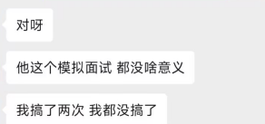

6.准备去某牛培训的学员自己慎重考虑，如你在网上发表培训经历，稍有对他们不利的评论，极有可能会在他们官号挂起同时面临起诉的风险哦。

7.此机构少有的优点就是 **态度比较好**，如：当时嵌入式学完毕后，有学员极度不满意，那边给的说法是，你愿意重新学习Java的话，可以免费学。还有，如果你遇到租房一类的问题，他们也可以帮你们解决。平时可能会送一些小福利丶安排一些小活动。 

当然，态度好的前提是你没发文吐槽它们。没有影响它们的饭碗。

8.关于66工作日退费的问题。这个我相信也有部分读者想要了解。在这里简单说一下，我了解的信息。**66工作不就业确实给你退费**。但是**有前提**的，一般**难以达到**。比如他们会和学员补签一份协议，规定【迟到2次算旷课一天，旷课两天视为自动放弃退费】，也就是严格来说你在5-6个月的学习时间中，只能迟到3天。

然后你就业需要签署离校协议，如果你后续被开除了或者别的什么原因（据网上别的帖子消息传，机构人员会打电话给你离职的公司，表示自己是培训机构人员，问你是自愿离职，还是因为技术不行被开除。），你必须重新返回某牛xy，继续计算时间（如你之前就业花了20工作日，工作了一个月，然后回来继续按照20天往上计数直到66天）。

**关于退费规定，实际你缴费所签定的协议之中，拥有更多规定，这里不再赘述。**

在实际情况中，我了解的情况是，一般是不会回去的，因为有的学员找的工作是外省的或者隔的很远，当你被开除，重新回某牛的话，比较麻烦，退房子扣押金，重新租房子。而且回去机构，帮助极其有限。所以多数是签自主就业，或者是被开了自己找，找不到就算了。（以上情况是个人了解，细节可能有出入）。

当时我们去的时候就听闻一个女生正在与此机构产生纠纷。这个女生好像是之前学前端的，有学员加了此位女生的VX，**聊天中该女生表示，机构就退费问题一直拖延，然后女生自己拿着合同去咨询了律师，律师给的回复是，按照机构合同上所写，你胜诉的几率不是很大。但是后面不知道什么情况，最后是退了**。

## 个人学习体验

**学习完毕后，水平可能强于大部分普通学校相关专业的学生，但是如果想仅仅依靠此机构的教学内容直接进入企业进行独立开发，几乎是不可能的，远达不到企业要求。 适合找一份实习或者助理的工作岗位比较合适。或者继续自己深入补充学习，方有可能胜任独立开发。**

所学的主要知识为**C语言丶STM32标准库基础配置，C++基础语法丶qt控件的基础了解**。驱动部分个人认为可以忽略，别说学员了，恐怕当时老师对这方面也不是很了解。**如果你准备找单片机。那么你在网上花一个多月的时间，耐心把C语言丶江科大自协STM32的教学视频看完，水平几乎是和在某牛学完所有课程是一模一样的。**

**老师水平引人质疑，感觉并没有嵌入式实际工作经验，为JAVA所转。项目含金量极低，和学生作业差不多。简历基本上靠抄袭往届学员加上AI加工。**

抱有花钱买项目目的的学员慎重考虑，因为**机构并不会带你实际做项目**，或者说只会带你做那种十分基础简单的丶类似学生作业一样的项目，如一阶段C语言和三阶段单片机。一般是教你基础知识，让你知道有这个技术。然后AI生成一堆要求给你做，如二阶段C++/QT和四阶段驱动。

## 个人对机构的感受

**课程不入流，控评一流**。全网估计也就B乎上面还有一两篇文章没被删除。 其余平台很多吐槽它们机构的文章都被删除了。你发个帖子，吧务盯着你删，把你发的和这个机构相关的所有帖子全部删掉。至于吧务为什么这么卖力，相信不用多说。

不少学员也发文章吐槽过此机构，不过当机构得知此类文章存在后，首先就会把发帖子踢出群聊，防止你在群里进行曝光。然后就会两步走，一是打电话让你删帖，如果你很强硬，且文章本身用词不当，如不小心用了贬损性词汇。那就起诉你，告你侵权。

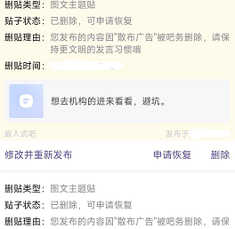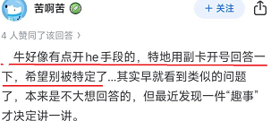

如果你发了文章，但是用词挑不出毛病，明知告侵权无望。它们就会自己在官号发文章进行颠倒黑白丶春秋话术丶睁眼说瞎话，把发帖者挂在它们官号。来试图“澄清”事实。

**宣传和实际严重不符，官网宣传的课程很多没讲，宣传的企业级项目**，它们自己讲师zyf都说连学生作业都不如。宣传的精通ARM丶拥有十余年经验的讲师，却连一些很基础的问题都不是很明白。还看江协科技的教学视频。

## 此机构自己的讲师对他们的项目的评价

**此机构讲师对它们项目的评价：**

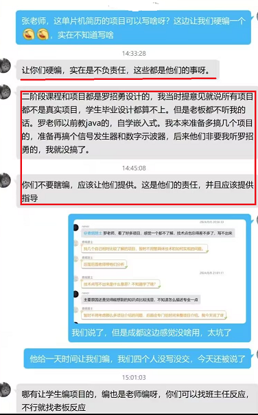

**此机构宣传的课表，标红的地方是没讲的，实际还有很多地方只是给你简单介绍其概念：**

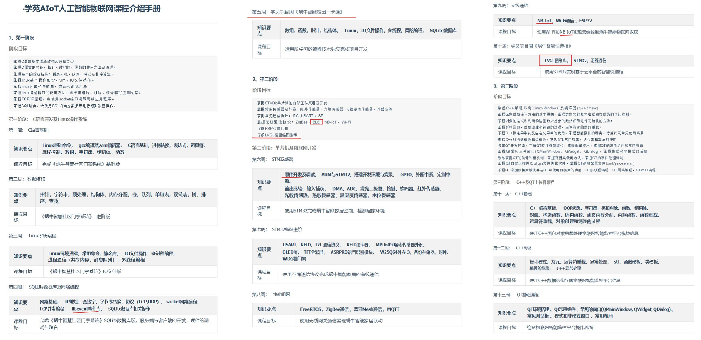

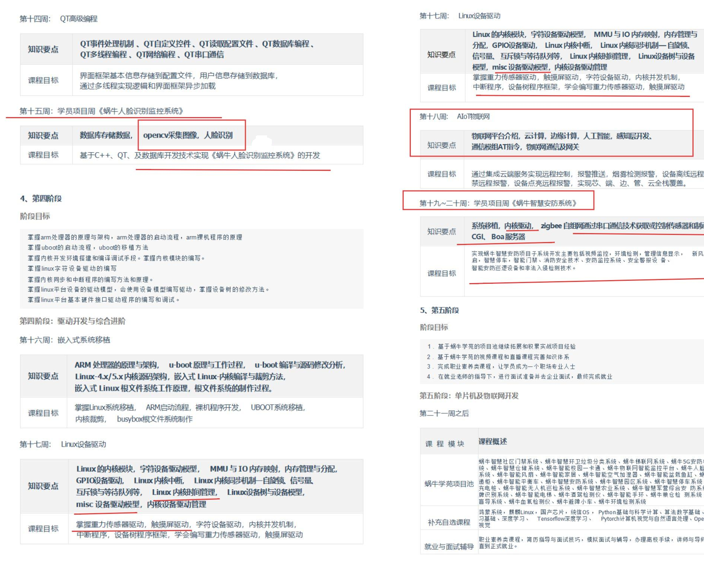

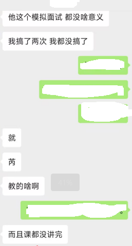

建议一定想去这个机构的，你直接问它们，你们讲师是谁？在哪个公司做的什么职位？有离职证明吗？

## 关于直播

直播我也看到过不少。曾今某次观看 **某某说IT** 的直播，真是深感无语。不知是否故意搞一二小号，每次进去这几个账号都在直播间，问着同样的机构，然后假装提问咨询与他们有合作的机构，然后它就进行解答。其一些言语我描述给你们听听：

路人甲：某嵌怎么样啊？

主播：（摇头晃脑，故作夸张状）那个某嵌啊，就我了解，就业率......，40%，40%吧，在一坨X里面算香的。

路人乙：某清怎么样啊？

主播：某清啊？就业率20%，......。

路人丙或小号：某某机构（和他们有合作的机构）怎么样啊？

主播：他们老师负责，就业辅导好，百分百都就业了。多少天之内都走完了。（春秋话术。当时真给我看笑了。）

**我挺好奇，为什么别人十几年的老机构不如刚开班的小机构啊？小机构的老师可能都是从老牌机构之中出来的。咋地？换个机构差别就这么大？是你推荐的机构有什么魔力吗？**

此主播还有一堆春秋话术：

如，认为一些机构校企合作，印象不好。实际上他推荐的某机构也想搞校企合作，还时不时安排老师去学校讲课，不过是因为别人要的比较多，他们可能不愿丶或者承担不起罢了。

如，认为某大型老牌机构课程太多，C+MCU+RTOS+QT+LINUX驱动等等，认为四个月安排这么多课程不合理，所以不推荐。 实际他推荐的机构，安排的课程也杂丶多。**甚至很大程度就是看着别人安排什么课程，他们就安排什么课程。**

如，认为某些机构不舍得在师资上花钱。实际他推荐的机构的师资还不如那些机构。 **此类春秋话术太多，在此我也懒得一一举例。**

**和被主播推荐去某牛学习JAVA的学员的部分聊天：**

再给大家讲讲主播 **某某怼机构**，一次偶尔看到此主播在讲某某机构，恰好本人比较了解，遂进入直播间观看。大意是一顿猛夸啊，例如：“你认为别人机构白开的吗？”，“别人机构有东西的”，反正一顿吹捧。 于是看到以下对话。

路人甲：“机构项目不怎么样啊”。

主播B：强行反驳。说机构项目可以写在简历上。

路人甲：“我在里面学过我不知道吗？项目不如毕设，简历全靠使用AI加工。”

主播B：（已经急眼，胡言乱语，开始骂人）“你咋这么轴呢？Sha比，GUN吧”（遂踢出直播间拉黑，【不要问我为啥知道被踢了】）

此类主播数不胜数，多如牛毛。后来经过观察，发现网上此类主播大概分为以下几类。

**一种如主播A，这类稍微高明一点，善用春秋话术，说的大部分确实是事实，但是属于挑着说，或者用碎片让你自己往他期待的方向进行脑补。就算后续你发现被坑了，也不能说他P你。**

**另一种就比较低级，如主播B。这类纯属乱说，乱吹，对实际情况是一丁点都不了解。P过去拿到推荐费完事，后续你要是找他理论，那无非就是拉黑。**

**还有一种极少类型的主播。这类相对市面上的主播还较好，不删评论，不发表评价，偶尔发几个所谓的暗访视频。虽然也有不少黑料。但是属于姜太公钓鱼，愿者上钩。不会像别的主播整天直播拉人。**典型的某讲假话的迅。

**这几者的最终极的目的，都是为了那些推荐费，每个机构的推荐费实际多少我并不确定，但是根据多方面消息，极大概率是4-5K。被推荐拿到所谓优惠的学员也不要沾沾自喜，羊毛出在羊身上，机构最后总是会把这部分开支加在你们学费里面的。事实也确实如我所讲，某牛的报名费早已对应涨价几千块**（补充一点，他们一直喜欢避重就轻，认为恰饭没错。我也认为恰饭没错，但是靠春秋话术，HY学生去你们合作的机构就太恶心了。）

**最后也劝某些博主的某些小天才粉丝，不要网上看几场直播，就对其只言片语奉为圭臬。被几句春秋话术忽悠的找不到北，一口一个这哥那老师的喊着，仿佛有某种无上荣耀加身一样。自己稍微动脑子想想，别人每天直播是为了什么？他能说他衣食父母的不是吗？**

**如果你想听真话，不如去网上随便找几个人问问。最简单的，你去某吧开个帖子问问，问问你想了解的主播的话语可不可信。问下你想了解的机构如何。里面不缺各大机构培训的学员。**

（这里再补充一个例子，某主播**龙某**合作的机构之一**某牛**。你自己去那个机构，随便找个学员，或者网上随便找个学员推荐。你们两个人每人可以拿800。甚至你直接和他们销售谈，可以把这两个800都给你，也就是直接给你优惠1600。你如果自己直接和机构负责人讲价，大概率可以优惠更多。 但是这位主播给的优惠是500（后面被曝光后好像改为1K），**现在你知道他们说的话有几分可信了吗？**）

## 内部学员部分评价截图

**12.最后这里贴几张学员对他们的评价，以及网上早些年他们的风评，如有不愿意者，请联系我删除。**

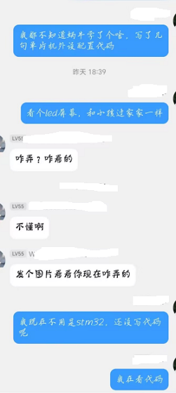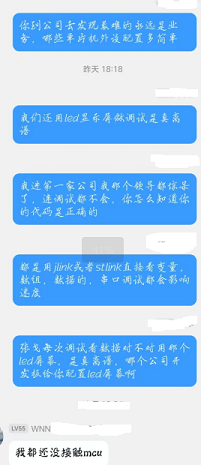

## 网上部分评价截图

**此机构网上评价截图：**

  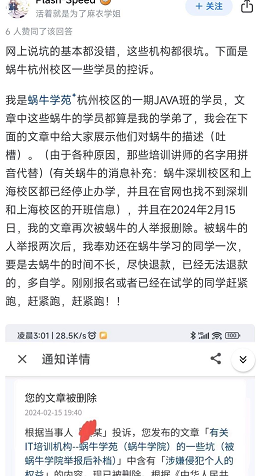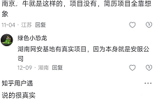

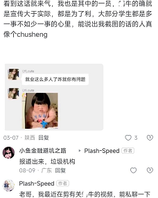

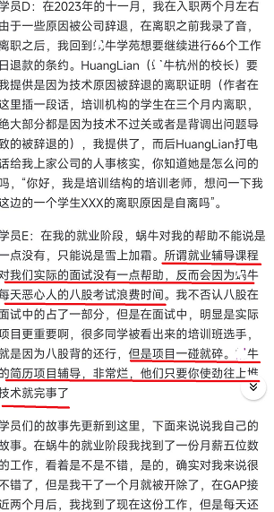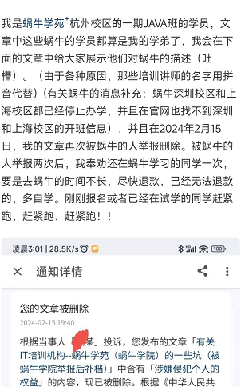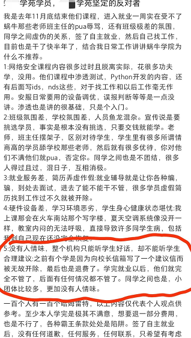

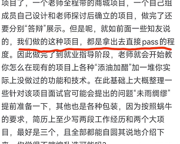

## 结语

**昔日常于直播间，见诸多初出茅庐之辈于择业之际踌躇，如稚子持金过闹市 ，目眩于"百人百就""师者全程督之"之诺******，浑不知春冰之下藏凛冬。余早时亦尝陷此局，故每见此，如观雏鸟坠蛛网，不忍见其为巧言所惑，每以肺腑之言诲其明辨。****

**然世有奇景：或隔万里重洋，于云端观直播，闻春秋之辞，虽被诓而犹呼师称兄者，此等大智若愚之辈，诚可叹也。 更有不识余诚者，反讥余为饶舌，更有向主播言余谤其短丶毁其誉者 。若农夫撒种于磐石，春来不见芽，唯闻风中戏谑声。**

**乃悟人生各有天命，如月映千川而迹异，强为干涉反失自然之理。遂知世情如镜，照见本心足矣，何必执炬迎风，扰他人星火之途？自此对培训之问，概以不知作答。诸君欲择何所、信何人，尽可自决，吾不复言矣。**
